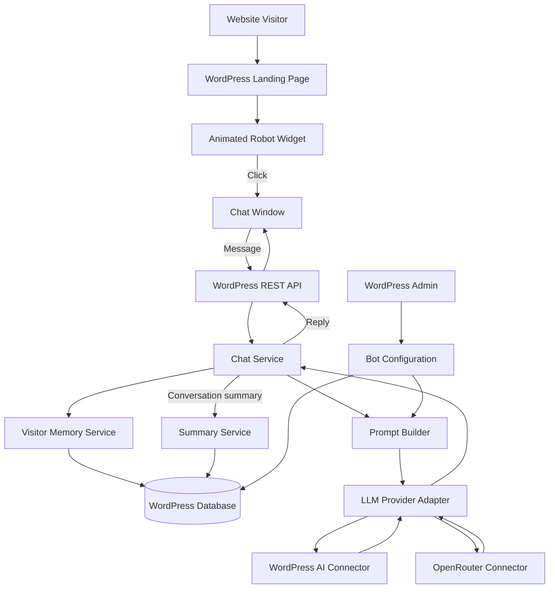
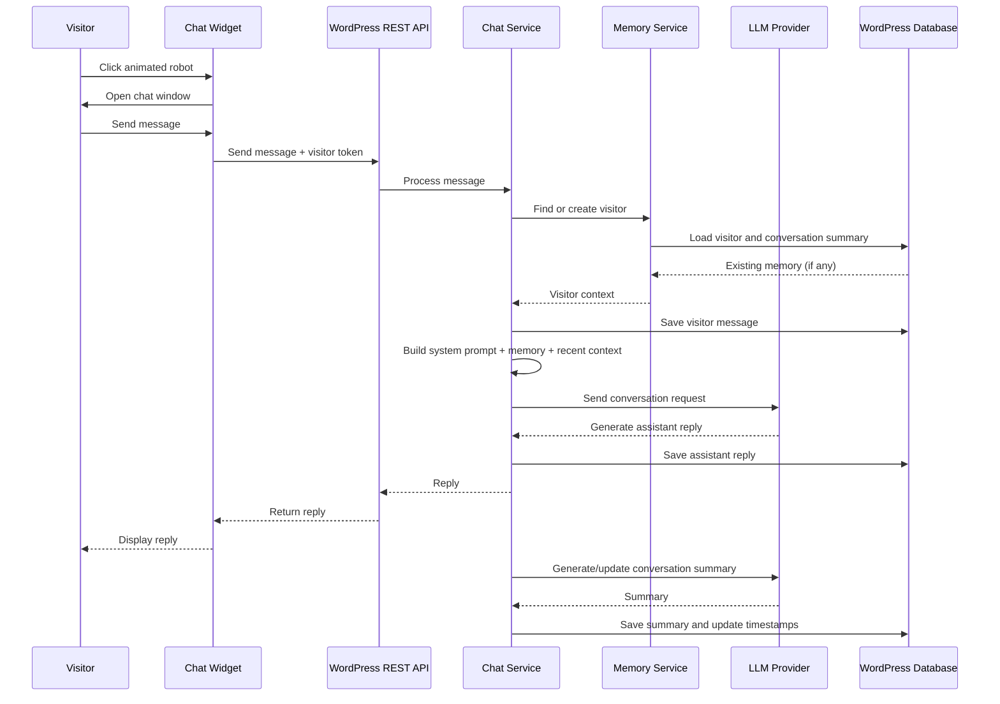

# WordPress AI Chatbot --- Architecture & Implementation Plan

> **Purpose:** Build a lightweight, configurable AI chatbot for a
> WordPress website. The chatbot appears as a cute animated robot on the
> landing page. Visitors can click the robot to open a chat window. The
> bot follows a site-owner-defined system prompt, talks naturally, and
> keeps a compact memory of visitor details and conversation summaries.
>
> **Source:** Prepared from the supplied meeting transcript
> (`Law.m4a.docx`). The available transcript covers approximately
> **00:00--09:19**. Details below are separated into **discussed
> requirements** and **implementation recommendations** where necessary.

------------------------------------------------------------------------

## 1. Product Overview

Build a WordPress plugin that provides:

1.  A floating, animated robot chatbot on the website landing page.
2.  A chat window that opens when the visitor clicks the robot.
3.  An LLM-powered conversation experience.
4.  A configurable system prompt / talking-instructions screen in the
    WordPress admin dashboard.
5.  Visitor memory that stores available identity details, visitor IP,
    approximate location, conversation date/time, and a conversation
    summary.
6.  LLM connectivity through the WordPress AI Connector by default, with
    an additional OpenRouter connector so site owners can use available
    free models.

The product should remain simple. Avoid adding unrelated features to the
first version.

## 2. Core Features

### 2.1 Visitor Memory

The system should remember visitors across conversations as far as the
available identifier permits.

Store the following information:

  -----------------------------------------------------------------------
  Field                               Description
  ----------------------------------- -----------------------------------
  Visitor ID                          Internal unique identifier

  Visitor IP                          IP address associated with the
                                      visitor/session

  Name                                Visitor-provided name; nullable

  Email                               Visitor-provided email; nullable

  Approximate location                Location derived from IP, if
                                      available

  First seen                          Date/time of first interaction

  Last seen                           Date/time of most recent
                                      interaction

  Conversation summary                Short AI-generated summary of the
                                      conversation

  Updated at                          Last record update time
  -----------------------------------------------------------------------

**Identity collection flow:**

-   The bot should politely ask the visitor for their name and, if they
    are comfortable sharing it, their email.
-   Explain that providing these details helps the bot recognize and
    assist them in the conversation.
-   If the visitor provides a name and email, save those details and
    associate them with the visitor record.
-   If the visitor does not provide them, keep the visitor record using
    the available visitor identifier (such as IP/session identifier);
    leave name and email empty.
-   The meeting discussed giving an unidentified visitor a random name
    so the bot can address them in a friendly way. If implemented, treat
    this as a **temporary nickname**, not as the visitor's real
    identity, and do not save it as a verified name.

**Privacy and reliability notes:**

-   Tell visitors what information is collected and why. Do not make
    name or email disclosure mandatory unless the site owner explicitly
    chooses that policy and communicates it.
-   IP-based location is approximate and may be unavailable or
    inaccurate.
-   IP addresses can be shared by multiple people or change over time.
    Do not use IP alone as a guaranteed unique identity. Prefer a random
    first-party visitor ID stored in a cookie or local browser storage,
    with IP as supporting metadata.
-   Provide an appropriate retention/deletion policy and protect stored
    personal data. Avoid exposing visitor records publicly.

### 2.2 Conversation History and Summary

For each conversation:

-   Record when the conversation happened.
-   Store the conversation data needed to generate a summary.
-   Generate a concise conversation summary.
-   Save the summary against the visitor/conversation record.
-   Reuse the summary as context when the same visitor returns, so the
    bot can continue with relevant context.

The transcript explicitly calls for keeping a **conversation summary**.
Storing every raw message is an implementation recommendation that makes
it possible to regenerate summaries and inspect conversation history. If
raw messages are stored, protect them and define a retention period.

### 2.3 Dynamic System Prompt / Talking Instructions

Create a WordPress admin screen where the site owner can edit the bot's
behavior.

The prompt should control:

-   How the bot speaks.
-   Tone, personality, and politeness.
-   How it asks for a visitor's name and email.
-   How it addresses visitors who do not provide their details.
-   The bot's role and instructions.
-   How it uses the available conversation summary.

The prompt must be **dynamic**: the site owner can change it without
editing code or redeploying the plugin. The LLM request should use the
latest saved prompt.

The transcript mentions a screen with prompt/instruction tabs. A simple
first version can provide one main prompt editor, with optional tabs
such as **System Prompt** and **Instructions** if that makes the admin
UI clearer.

### 2.4 Animated Robot and Chat Widget

Frontend requirements:

-   Show a cute, animated, robotic character/body on the landing page.
-   The robot should have a waving-hand animation.
-   Do not show a separate paw/button; the robot itself is the clickable
    target.
-   The robot may be represented by an animated GIF or another
    lightweight animation.
-   A small tooltip such as **"Click me"** may appear to invite
    interaction.
-   Clicking the robot opens the chat window.
-   The chat window contains a message area and an input field.
-   The visitor sends a message and receives an LLM-generated response.

The robot/chat widget must be usable on common desktop and mobile screen
sizes.

### 2.5 LLM Providers

Support two connection options:

1.  **WordPress AI Connector** --- the default/integrated connection
    path discussed in the meeting.
2.  **OpenRouter connector** --- an additional provider connection. It
    allows site owners to select from the models available through
    OpenRouter, including free models where currently offered.

Recommended provider design:

-   Keep provider-specific code behind one common LLM adapter interface.
-   Store provider selection and credentials securely in WordPress
    settings.
-   Never expose API keys in frontend JavaScript.
-   Allow the site owner to select a model where the provider supports
    model selection.
-   Handle provider errors and timeouts gracefully.

Do not assume that every model is free or permanently available. Model
availability, pricing, rate limits, and context limits depend on the
provider and can change.

------------------------------------------------------------------------

## 3. High-Level Architecture



### Main components

  -----------------------------------------------------------------------
  Component                           Responsibility
  ----------------------------------- -----------------------------------
  Frontend Chat Widget                Displays robot, tooltip, chat
                                      window, messages, and input

  WordPress REST API                  Receives visitor messages and
                                      returns bot replies

  Chat Service                        Orchestrates each conversation turn

  Visitor Memory Service              Identifies visitors and loads/saves
                                      memory

  Prompt Builder                      Combines configured instructions
                                      with conversation context

  LLM Provider Adapter                Sends requests to the selected
                                      provider

  Summary Service                     Creates and updates conversation
                                      summaries

  WordPress Admin Settings            Manages prompt, provider, model,
                                      and widget settings

  WordPress Database                  Stores visitor, conversation,
                                      message, and configuration data
  -----------------------------------------------------------------------

## 4. Suggested WordPress Plugin Structure

The following is a recommended structure, not a folder layout explicitly
specified in the meeting.

``` text
wp-ai-robot-chat/
├── wp-ai-robot-chat.php
├── readme.txt
├── uninstall.php
├── includes/
│   ├── class-plugin.php
│   ├── class-database.php
│   ├── class-rest-controller.php
│   ├── class-chat-service.php
│   ├── class-visitor-memory.php
│   ├── class-prompt-builder.php
│   ├── class-summary-service.php
│   ├── class-settings.php
│   └── providers/
│       ├── interface-llm-provider.php
│       ├── class-wordpress-ai-provider.php
│       └── class-openrouter-provider.php
├── admin/
│   ├── class-admin-page.php
│   ├── views/
│   │   ├── settings-page.php
│   │   └── memory-page.php
│   └── assets/
│       ├── admin.css
│       └── admin.js
├── public/
│   ├── class-chat-widget.php
│   ├── views/
│   │   └── chat-widget.php
│   └── assets/
│       ├── css/chat-widget.css
│       ├── js/chat-widget.js
│       └── images/robot-animation.gif
└── languages/
```

Keep the plugin modular. Do not put database queries, provider calls,
prompt construction, and frontend rendering into one large PHP file.

## 5. Database Design

Use WordPress custom database tables for structured visitor and
conversation data. Use the WordPress table prefix rather than hardcoding
`wp_`.

### 5.1 Visitors table

Suggested table: `{prefix}bot_visitors`

  -----------------------------------------------------------------------
  Column                  Suggested type          Notes
  ----------------------- ----------------------- -----------------------
  id                      BIGINT, primary key     Internal visitor ID

  visitor_token           VARCHAR(100), unique    Random first-party
                                                  visitor identifier

  ip_address              VARCHAR(45), nullable   Supports IPv4 and IPv6

  name                    VARCHAR(190), nullable  Visitor-provided name

  email                   VARCHAR(190), nullable  Visitor-provided email

  approximate_location    VARCHAR(255), nullable  IP-derived, if
                                                  available

  first_seen_at           DATETIME                First interaction

  last_seen_at            DATETIME                Latest interaction

  created_at              DATETIME                Record creation

  updated_at              DATETIME                Last update
  -----------------------------------------------------------------------

### 5.2 Conversations table

Suggested table: `{prefix}bot_conversations`

  Column                 Suggested type        Notes
  ---------------------- --------------------- ----------------------
  id                     BIGINT, primary key   Conversation ID
  visitor_id             BIGINT, indexed       References visitor
  conversation_summary   LONGTEXT, nullable    AI-generated summary
  started_at             DATETIME              Conversation start
  last_message_at        DATETIME, nullable    Latest message
  created_at             DATETIME              Record creation
  updated_at             DATETIME              Last update

### 5.3 Messages table

Suggested table: `{prefix}bot_messages`

  Column            Suggested type        Notes
  ----------------- --------------------- -------------------------
  id                BIGINT, primary key   Message ID
  conversation_id   BIGINT, indexed       Associated conversation
  role              VARCHAR(20)           `user` or `assistant`
  message           LONGTEXT              Message content
  created_at        DATETIME              Message timestamp

The transcript explicitly describes a memory table containing visitor
IP, name, email, date/time, and conversation summary. The separate
visitors/conversations/messages tables above are a recommended
normalized implementation of that idea.

### 5.4 Configuration storage

Use WordPress options for plugin configuration, for example:

-   Selected LLM provider.
-   Selected model.
-   Encrypted or otherwise securely protected provider credentials,
    where practical.
-   System prompt.
-   Talking instructions.
-   Widget enabled/disabled state.
-   Optional summary and retention settings.

Do not store secrets in publicly readable frontend settings or return
them from REST API responses.

------------------------------------------------------------------------

## 6. Conversation Flow



### Step-by-step behavior

1.  The visitor opens the landing page.
2.  The animated robot appears.
3.  The visitor clicks the robot and the chat window opens.
4.  The widget creates or retrieves a first-party visitor token.
5.  The visitor sends a message.
6.  The REST API validates the request and passes it to the Chat
    Service.
7.  The Memory Service finds or creates the visitor record.
8.  The system loads the latest conversation summary and relevant recent
    messages.
9.  The Prompt Builder combines:
    -   The site owner's current system prompt.
    -   The configured talking instructions.
    -   Visitor details, if provided.
    -   Existing conversation summary.
    -   Recent conversation messages.
    -   The visitor's new message.
10. The selected LLM provider generates a reply.
11. The system saves the visitor message and assistant reply.
12. The widget displays the reply.
13. The system generates or refreshes the conversation summary and saves
    it.

**Implementation note:** Summary generation can happen after the reply
or through a background task. The first version may use a simple
synchronous approach, but avoid making the visitor wait unnecessarily.

------------------------------------------------------------------------

## 7. Prompt Design

The system prompt must be editable by the WordPress site owner. The
following is an example starter prompt; it is not a fixed prompt from
the meeting.

``` text
You are the website's friendly AI assistant.

Communication:
- Speak politely, naturally, and helpfully.
- Follow the tone and behavior instructions configured by the website owner.
- Keep answers clear and relevant.
- Do not claim to know a visitor's identity unless they have provided it.

Visitor recognition:
- When appropriate, politely ask for the visitor's name and email.
- Explain that sharing these details can help personalize future assistance.
- Do not pressure the visitor if they decline.
- If the visitor provides a name, use it naturally in the conversation.
- If the visitor does not provide a name, you may use a friendly temporary nickname if enabled.
- Never present a temporary nickname as the visitor's real name.

Memory:
- Use the supplied conversation summary only when relevant.
- Do not invent previous conversations or personal details.
- If information is missing or uncertain, ask the visitor.

Business/site instructions:
{{SITE_OWNER_INSTRUCTIONS}}
```

The application should send the prompt as a system/developer instruction
according to the selected provider's API format. Do not concatenate
untrusted visitor messages into the system prompt.

------------------------------------------------------------------------

## 8. Proposed REST API

These endpoint names are implementation proposals. The meeting describes
the message-to-LLM connection but does not specify endpoint names or
request schemas.

  ----------------------------------------------------------------------------------------------
  Method                  Endpoint                                       Purpose
  ----------------------- ---------------------------------------------- -----------------------
  GET                     `/wp-json/robot-chat/v1/config`                Return public widget
                                                                         configuration only

  POST                    `/wp-json/robot-chat/v1/conversations`         Create or resume a
                                                                         conversation

  POST                    `/wp-json/robot-chat/v1/messages`              Submit a visitor
                                                                         message and receive a
                                                                         reply

  GET                     `/wp-json/robot-chat/v1/conversations/{id}`    Retrieve an authorized
                                                                         conversation

  GET                     `/wp-json/robot-chat/v1/admin/visitors`        Admin-only
                                                                         visitor/memory list

  GET                     `/wp-json/robot-chat/v1/admin/visitors/{id}`   Admin-only visitor
                                                                         details and summaries

  PUT                     `/wp-json/robot-chat/v1/admin/settings`        Admin-only
                                                                         configuration update
  ----------------------------------------------------------------------------------------------

### Example message request

``` json
{
  "visitor_token": "random-first-party-token",
  "conversation_id": 123,
  "message": "Hello, I need some information."
}
```

### Example response

``` json
{
  "conversation_id": 123,
  "reply": "Hello! I'd be happy to help. What would you like to know?"
}
```

Do not expose private visitor records through public endpoints. Apply
WordPress capability checks to admin routes.

------------------------------------------------------------------------

## 9. WordPress Admin Dashboard

Create a simple plugin menu in the WordPress dashboard.

### 9.1 Bot Instructions / System Prompt

-   A text editor or textarea for the system prompt.
-   A separate instructions area or tabs if useful.
-   Save button.
-   Load the latest saved prompt for each new LLM request.

### 9.2 LLM Settings

-   Provider selection: WordPress AI Connector or OpenRouter.
-   Model selection, where supported.
-   API credential field for providers that require it.
-   Connection/test status, if supported by the provider integration.

### 9.3 Memory / Visitors

Display a table containing:

-   Visitor IP.
-   Name.
-   Email.
-   Approximate location.
-   First/last interaction date and time.
-   Conversation summary.

Use pagination and search for the admin list. Restrict access to
authorized administrators.

------------------------------------------------------------------------

## 10. Frontend Widget Behavior

### Initial state

-   Display the animated robot on the landing page.
-   Robot animation can wave its hand.
-   Show a small "Click me" tooltip if desired.
-   The robot itself is clickable.

### Open state

-   Clicking the robot opens the chat window.
-   Show conversation messages.
-   Show a text input and send action.
-   Provide a visible way to close or minimize the chat.

### Message state

-   Show a loading/typing indicator while waiting for the LLM.
-   Append the visitor's message.
-   Display the assistant's response.
-   Handle network/provider errors with a friendly message.

### UI guidance

-   Keep the widget lightweight and responsive.
-   Ensure the chat window does not cover important page controls on
    mobile.
-   Make the robot and chat controls keyboard-accessible.
-   Respect reduced-motion preferences where possible.

------------------------------------------------------------------------

## 11. Security, Privacy, and Reliability

These are implementation safeguards recommended for a public-facing
WordPress plugin.

1.  **Input validation:** Validate message length, visitor token,
    conversation ID, and email format.
2.  **Output escaping:** Escape user and model-generated content before
    rendering. Do not render arbitrary model HTML.
3.  **Rate limiting:** Limit message frequency per visitor/token and IP
    to reduce abuse and unexpected LLM costs.
4.  **Admin authorization:** Use WordPress capabilities such as
    `manage_options` for settings and visitor records.
5.  **REST API protection:** Validate request methods, parameters, and
    permissions. Do not rely on a public nonce as the only protection
    for anonymous visitors.
6.  **Secret handling:** Keep provider API keys on the server. Never
    send them to the browser.
7.  **Data minimization:** Collect only information needed for the
    feature. Explain collection of IP, email, and conversation data.
8.  **Retention:** Define how long IP addresses, messages, and summaries
    are retained, and provide a deletion mechanism.
9.  **Provider failures:** Handle timeouts, invalid API keys, rate
    limits, and unavailable models gracefully.
10. **Database safety:** Use prepared queries and WordPress database
    APIs appropriately.
11. **Visitor identity:** Use a random first-party token as the primary
    anonymous identifier. IP should be supporting information, not the
    sole identity key.
12. **Prompt safety:** Treat visitor messages as untrusted input. Do not
    let a visitor message override the site owner's system instructions.

------------------------------------------------------------------------

## 12. Development Plan

Build the product in small stages.

### Phase 1 --- Plugin foundation

-   Create the WordPress plugin.
-   Add activation/deactivation hooks.
-   Create database tables.
-   Add plugin menu and basic settings page.

### Phase 2 --- Robot and chat interface

-   Add the animated robot to the landing page.
-   Make the robot clickable.
-   Build the open/close chat window.
-   Add message input, message list, and loading/error states.

### Phase 3 --- LLM integration

-   Implement a common provider interface.
-   Integrate the WordPress AI Connector.
-   Integrate OpenRouter as an additional provider.
-   Keep API credentials server-side.
-   Test successful replies and provider errors.

### Phase 4 --- Visitor memory

-   Create a first-party visitor token.
-   Capture IP as supporting metadata.
-   Derive approximate location only if a suitable IP geolocation
    service is configured/available.
-   Ask for name and email politely through the configured prompt.
-   Save visitor details when voluntarily provided.
-   Keep nullable name/email when not provided.
-   Support a temporary nickname if enabled.

### Phase 5 --- Conversation summaries

-   Save messages.
-   Generate a concise summary.
-   Save the summary against the conversation/visitor.
-   Load relevant summary context when the visitor returns.

### Phase 6 --- Admin configuration and testing

-   Complete system prompt/instruction editing.
-   Complete provider/model settings.
-   Add visitor memory table view.
-   Test desktop/mobile layout, security, privacy, rate limiting, and
    provider failures.

------------------------------------------------------------------------

## 13. Acceptance Criteria

The first version is ready for review when:

-   [ ] The plugin can be installed and activated in WordPress.
-   [ ] The animated robot appears on the landing page.
-   [ ] Clicking the robot opens the chat window.
-   [ ] A visitor can send a message and receive an LLM response.
-   [ ] The site owner can edit and save the system prompt without
    changing code.
-   [ ] The bot follows the saved prompt on subsequent requests.
-   [ ] The site can use the WordPress AI Connector.
-   [ ] The site can use OpenRouter when configured.
-   [ ] A visitor token is created and reused.
-   [ ] Visitor IP and timestamps are stored where available and
    permitted.
-   [ ] Name and email are stored when voluntarily provided.
-   [ ] Name and email remain empty when not provided.
-   [ ] A conversation summary is generated and stored.
-   [ ] Relevant summary context can be loaded for a returning visitor.
-   [ ] Admin-only visitor data is not exposed through public endpoints.
-   [ ] API keys are not exposed in frontend code.
-   [ ] Basic validation, rate limiting, and error handling are in
    place.

------------------------------------------------------------------------

## 14. Decisions Still Needed

The transcript does not specify the following technical choices. Confirm
them before implementation rather than assuming them:

1.  **WordPress AI Connector API:** Which exact plugin/API version and
    integration method will be used?
2.  **OpenRouter configuration:** Should the site owner enter an API
    key, select a model, or both?
3.  **Visitor identity:** Should a first-party browser token be used in
    addition to IP? Recommended: yes.
4.  **Location lookup:** Which geolocation provider, if any, should be
    used?
5.  **Message retention:** How long should raw messages and summaries be
    stored?
6.  **Summary timing:** Update the summary after every message, at the
    end of a conversation, or periodically?
7.  **Robot asset:** Will the project provide an animated GIF/Lottie
    asset, or should a simple animation be created?
8.  **Widget placement:** The meeting explicitly mentions the landing
    page. Should it also appear on other pages?

## 15. Instructions for Claude Code

You are implementing a lightweight AI chatbot as a WordPress plugin.

Use this document as the product and architecture specification.

Important implementation rules:

-   First inspect the existing repository and identify its
    WordPress/plugin structure before making changes.
-   Do not assume an existing frontend framework or build tool; inspect
    the project first.
-   Implement the plugin in modular PHP classes and keep frontend assets
    separate.
-   Use WordPress conventions for hooks, settings, database access, REST
    routes, escaping, sanitization, and capability checks.
-   Implement the WordPress AI Connector and OpenRouter behind a common
    provider interface.
-   Keep all provider credentials server-side.
-   Build the animated robot and chat window according to the
    interaction described above.
-   Implement visitor memory, conversation storage, and summaries.
-   Keep the system prompt editable from the WordPress admin dashboard.
-   Do not add unrelated features.
-   Do not invent provider APIs. Inspect the installed WordPress AI
    Connector documentation/version and implement against the actual
    available interface.
-   If a decision is not specified in this document, choose the simplest
    safe option and document the decision. Ask for clarification when
    the choice would materially change the product.
-   Work in stages, run available tests/linting, and report files
    changed, setup steps, and any remaining limitations.

**Start by inspecting the repository and reporting the existing
structure. Then implement Phase 1 before proceeding to the next
phases.**
